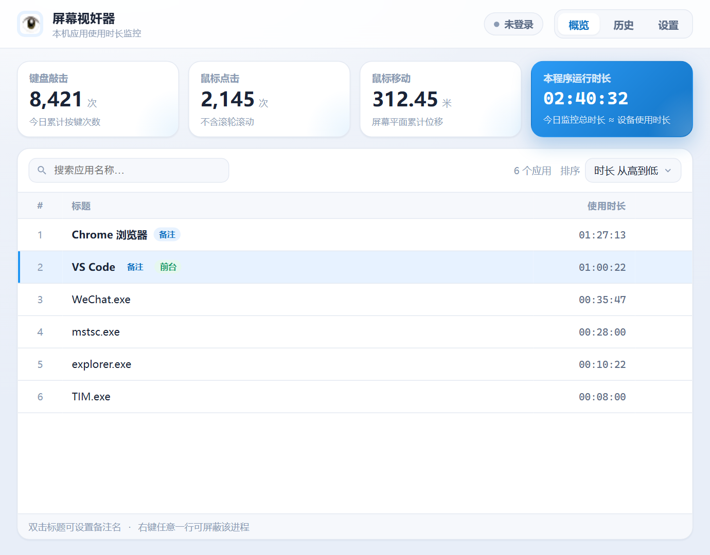
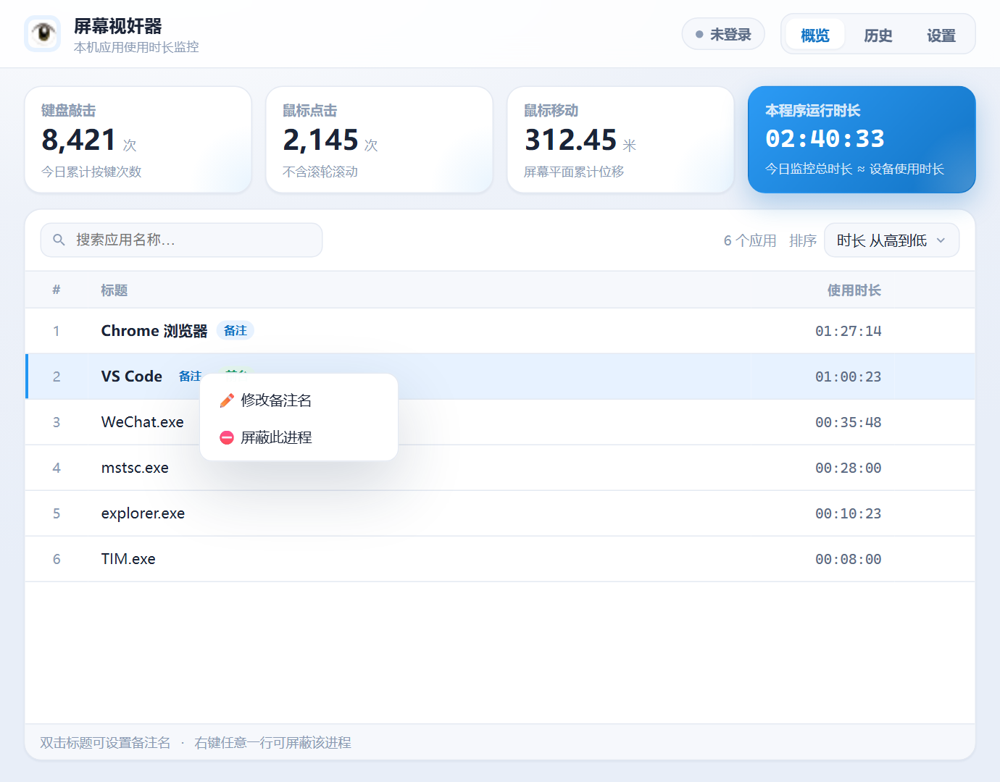
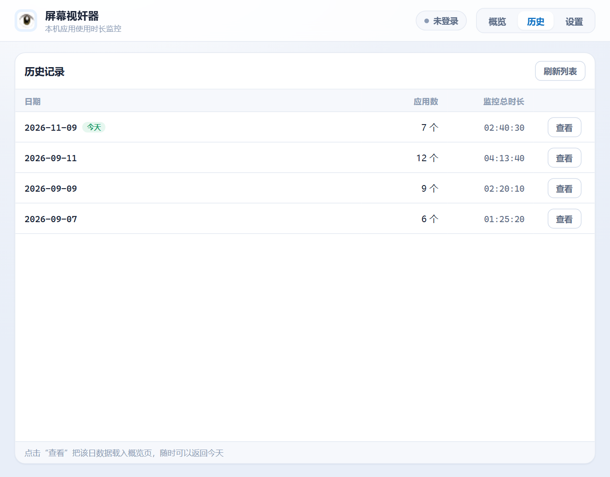
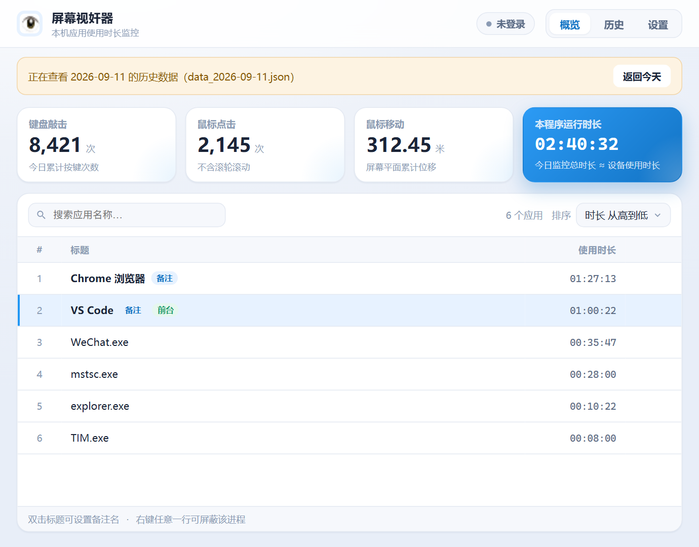
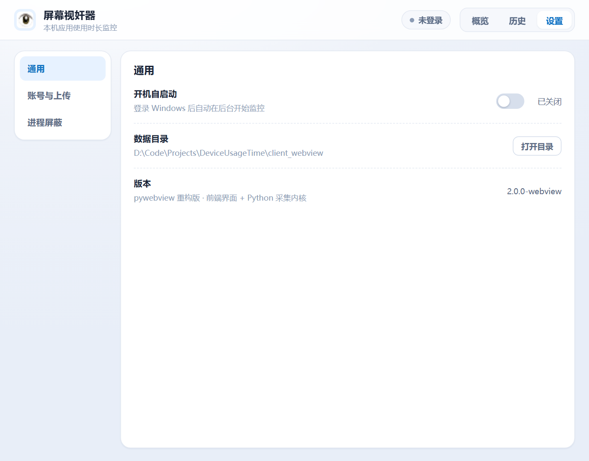
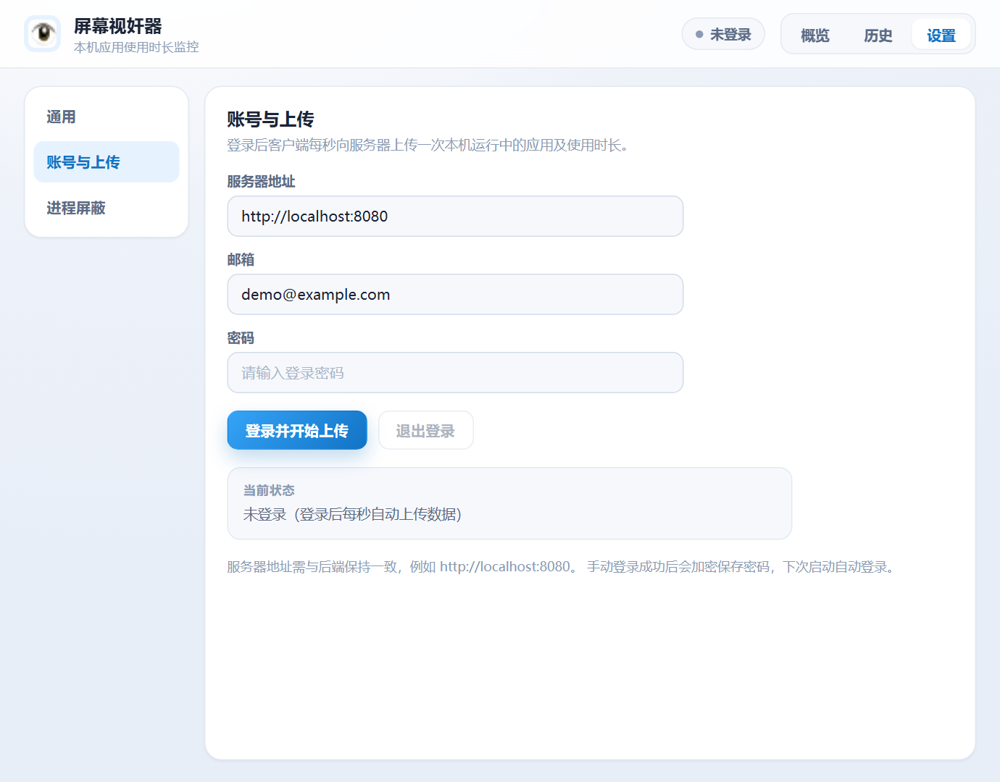
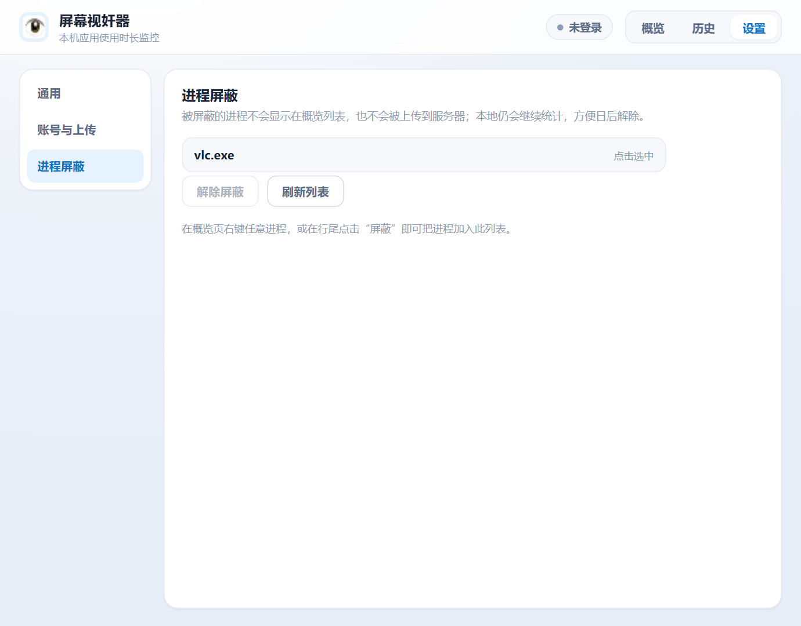
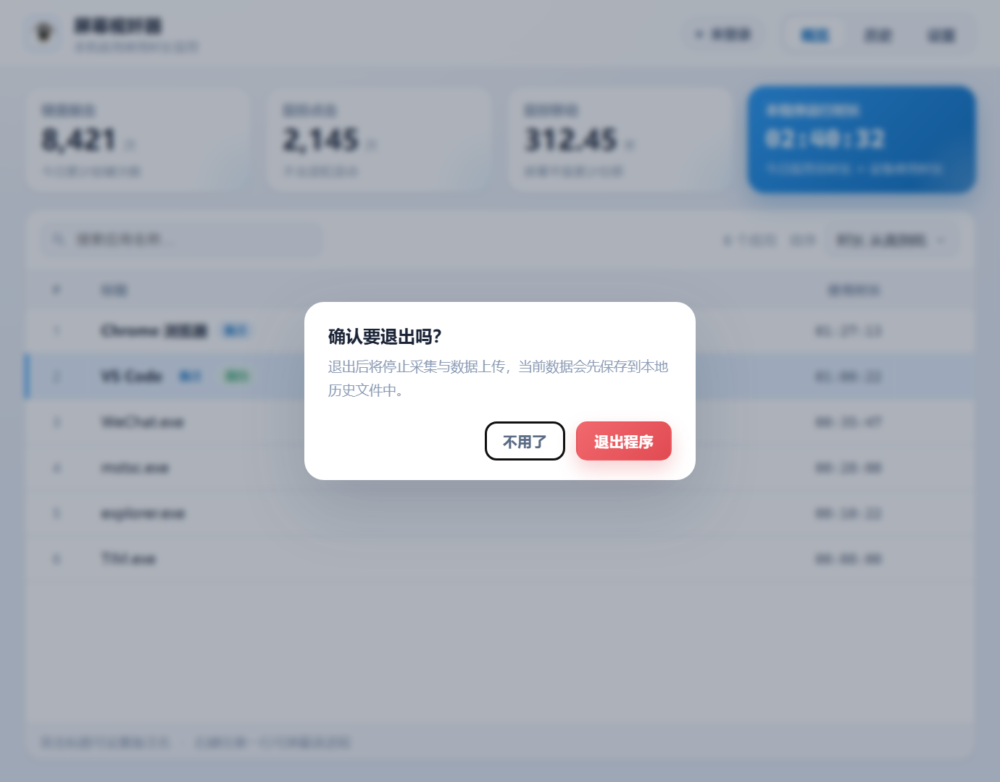

# 屏幕视奸器 · DeviceUsageTime

> Windows 本机应用使用时长监控 —— 桌面客户端（pywebview 重构版）+ 自建 Web 看板（Spring Boot + Vue3）

[](https://github.com/changchang-max/DeviceUsageTime/actions/workflows/ci.yml)
[](https://github.com/changchang-max/DeviceUsageTime/releases/tag/nightly)


客户端常驻系统托盘，每秒采集一次前台窗口与进程列表，按进程累计使用时长，并统计键盘敲击、鼠标点击、鼠标移动距离。数据每分钟落盘到本地，登录账号后还会每秒增量上传到自建后端，随时在 Web 端查看实时与历史数据。

> 仅支持 Windows。Web 部分是自建的监控看板，可以自己部署，也可以只当纯本地工具用（不登录、不上传）。

## 功能一览

| 功能 | 说明 |
| --- | --- |
| 进程时长统计 | 按进程名合并同一程序的多窗口；后台进程仍按 pid 存活判断，避免重复计数 |
| 输入统计 | 键盘敲击次数、鼠标点击次数、鼠标平面移动距离（滚轮按 3px/格折算进移动距离） |
| 应用备注名 | 双击标题内联编辑，进程名旁显示「备注」徽标 |
| 进程屏蔽 | 右键菜单或行尾「屏蔽」按钮，屏蔽后不显示、不上传，本地仍继续统计，可在设置页解除 |
| 搜索与排序 | 4 种排序（时长 / 名称 × 升降序），配置持久化；搜索只过滤当前快照，不打服务器 |
| 历史回看 | 「历史」页列出每日数据文件，载入后概览页顶部出现提示条，一键「返回今天」 |
| 系统托盘 | 最小化隐藏到托盘，托盘菜单可恢复窗口或退出程序 |
| 单实例运行 | 命名互斥量保护，重复启动会把已运行的窗口唤到前台后自行退出 |
| 退出确认 | 拦截窗口关闭事件，确认后先保存数据再退出；托盘「退出」走同一流程 |
| 开机自启 | 登录 Windows 后自动后台启动，状态在设置页实时显示 |
| 数据上传 | 登录后每秒上传一次，顶栏胶囊显示未登录 / 准备上传 / 上传正常 / 上传失败 / 登录已失效 |

## 界面预览

| 概览（实时统计） | 右键菜单（备注 / 屏蔽） |
| --- | --- |
|  |  |

| 历史记录列表 | 载入某天历史数据 |
| --- | --- |
|  |  |

| 设置 · 通用 | 设置 · 账号与上传 |
| --- | --- |
|  |  |

| 设置 · 进程屏蔽 | 退出确认 |
| --- | --- |
|  |  |

> 截图取自客户端内置的前端演示模式（`index.html?mock=1`），数据为模拟值，不代表真实用户数据。

## 项目结构

```
DeviceUsageTime/
├── client_webview/            # 【新版客户端】pywebview + 原生前端（当前主力，CI 打包的就是它）
│   ├── main.py                # 入口：窗口 + 本机静态服务 + 单实例 + 托盘
│   ├── monitor.py             # 后台采集：进程时长 / 输入统计 / 自动保存 / 数据上传
│   ├── api.py                 # js_api 桥接层，前端通过 window.pywebview.api.* 调用
│   ├── store.py               # 配置、备注、屏蔽名单、加密密码、历史数据读写
│   ├── network.py             # 与 Spring Boot 后端通信
│   ├── server.py              # 本机静态文件服务（前端资源）
│   ├── tray.py                # 系统托盘
│   ├── mytools.py             # 资源路径、通用工具
│   ├── web/                   # 前端界面（HTML + CSS + 原生 ES Module）
│   ├── main.spec              # PyInstaller 打包配置（web/ 资源一并打入）
│   └── package.txt            # Python 依赖
├── client/                    # 【旧版客户端】PyQt5 实现，保留作为参考
├── server/
│   ├── backend/               # Spring Boot 3 + MyBatis + MySQL + Redis + WebSocket
│   └── frontend/              # Vue3 + TypeScript + Element Plus + ECharts
├── docs/                      # 项目文档与 README 截图
├── .github/workflows/ci.yml   # 后端编译、前端构建、Windows 客户端打包与 Release
├── docker-compose.yml         # MySQL + Redis + 后端 + 前端 一键部署
└── AGENTS.md                  # 贡献者开发规范
```

## 快速开始

### 方式一：直接下载 exe

| 渠道 | 说明 |
| --- | --- |
| [GitHub Release（nightly）](https://github.com/changchang-max/DeviceUsageTime/releases/tag/nightly) | **推荐**。每次推送自动覆盖更新，产物为单文件 `DeviceUsageTime.exe` |
| [GitHub Actions](https://github.com/changchang-max/DeviceUsageTime/actions/workflows/ci.yml) | 每次构建的产物 `DeviceUsageTime-Windows-x64`，可在对应 run 页面下载 |
| 旧版（PyQt5）蓝奏云 | <https://wwfm.lanzoub.com/iMigp3ao0tah> 密码 `f0cp`，对应 `client/` 旧版界面，更新可能不及时 |

exe 为绿色单文件，双击即可运行；首次运行会在 exe 同目录创建 `config/`、`history_data/` 与 `crash.log`。

### 方式二：从源码运行客户端

> 需要 Python 3.10+，推荐用 conda 管理环境。

```bash
# 1. 创建并激活环境
conda create --name DeviceUsageTime python=3.10
conda activate DeviceUsageTime

# 2. 进入新版客户端目录并安装依赖
cd client_webview
pip install -r package.txt

# 3. 运行（加 --debug 可右键审查元素）
python main.py
```

可用参数：`--debug` 打开调试模式、`--width/--height` 指定窗口尺寸（默认 920×700）、`--port` 指定静态服务端口（默认随机）。

只调界面时不必启动 Python，前端自带 mock 数据：

```bash
python -m http.server 8899 --directory client_webview/web
# 浏览器打开：http://127.0.0.1:8899/index.html?mock=1
# 深链直达某个页面：#history、#settings/general、#settings/account、#settings/blocked
```

### 打包 exe

```bash
cd client_webview
pyinstaller main.spec --noconfirm --clean
# 产物：client_webview/dist/DeviceUsageTime.exe
```

一定要用 `main.spec`，因为前端 `web/` 目录需要通过 `datas` 一并打进包里，打包后由 `mytools.resource_dir()` 在 `sys._MEIPASS` 下定位。

### 后端（Spring Boot）

> 需要 Java 17+（CI 使用 Java 21）、Maven、MySQL 8、Redis 7。

```bash
cd server/backend
mvn clean package -Dmaven.test.skip=true
java -jar target/backend-0.0.1-SNAPSHOT.jar
```

配置从环境变量读取（`application.yaml` 中没有硬编码任何密码）。本地直接跑 jar 时至少要有：

| 变量 | 说明 |
| --- | --- |
| `MYSQL_USER` / `MYSQL_PASSWORD` | 数据库账号；`MYSQL_HOST`、`MYSQL_PORT`、`MYSQL_DATABASE` 可选，默认 `localhost:3306/deviceusagetime` |
| `REDIS_HOST` / `REDIS_PORT` | 默认 `localhost:6379` |
| `EMAIL_SENDER` / `EMAIL_PASSWORD` | QQ 邮箱账号与 SMTP 授权码，用于注册验证码 |
| `JWT_SECRET` | JWT 签名密钥 |

Docker 部署时这些值写在 `.env`（参考 `.env.example`，其中 `MYSQL_ROOT_PASSWORD` 会同时作为容器的数据库密码）。后端默认监听 `8080`。

### 前端（Vue3）

```bash
cd server/frontend
npm ci
npm run dev      # 开发模式
npm run build    # 生产构建，产物在 dist/
```

### Docker Compose 一键部署

```bash
cp .env.example .env   # 填写 MySQL 密码、邮箱授权码、JWT 密钥等
docker compose up -d   # mysql + redis + backend + frontend(Nginx)
```

默认端口：前端 `80`、后端 `8080`、MySQL `3306`、Redis `6379`，均可在 `.env` 里覆盖。

## 本地数据与配置

| 路径（相对客户端目录） | 用途 |
| --- | --- |
| `config/config.json` | 排序方式、开机自启状态、服务器地址、登录信息 |
| `config/alias.json` | 应用备注名 |
| `config/blocked_processes.json` | 被屏蔽的进程名单 |
| `history_data/data_YYYY-MM-DD.json` | 按天保存的历史数据，**与旧版 PyQt5 客户端格式兼容，可互读** |
| `crash.log` | 未捕获异常的崩溃日志 |

这些运行时文件都已被 `.gitignore` 忽略，不会进入仓库。服务器侧则是 `Redis（近 7 天热数据）→ MySQL（冷数据归档）` 的两级存储。

## 技术栈

| 层 | 选型 |
| --- | --- |
| 客户端 | Python 3.10+ · pywebview 6 · psutil · pynput · pystray · 原生 HTML/CSS/ES Module（无前端框架、无构建步骤） |
| 后端 | Java 17+ · Spring Boot 3.5 · Spring Security + JWT · MyBatis · MySQL 8 · Redis 7 · WebSocket |
| Web 前端 | Vue 3 · TypeScript · Vite · Element Plus · Pinia · ECharts |
| 构建分发 | PyInstaller（单文件 exe）· Maven · npm · Docker Compose · GitHub Actions |

## 后端接口速览

基础地址 `http://<host>:8080/api`，除登录/注册/验证秘钥外均需 `Authorization: Bearer <token>`。

| 方法 | 路径 | 说明 |
| --- | --- | --- |
| GET | `/api/auth/sendCode` | 发送邮箱验证码（Redis 存 5 分钟） |
| POST | `/api/auth/register` | 注册 |
| POST | `/api/auth/login` | 登录，返回 JWT |
| POST | `/api/auth/logout` | 退出登录 |
| POST | `/api/auth/change-password` | 修改密码 |
| POST | `/api/auth/deregister` | 注销账号并清理关联数据 |
| GET | `/api/auth/verify-key` | 用秘钥校验，查看者免注册访问 |
| GET | `/api/user/profile` | 获取用户信息（客户端也用它校验 Token 是否有效） |
| POST | `/api/user/regenerate-key` / `revoke-key` | 重新生成 / 作废查看秘钥 |
| POST | `/api/user/regenerate-upload-credential` / `revoke-upload-credential` | 重新生成 / 作废上传凭证 |
| POST | `/api/data/upload` | 上传增量数据（客户端每秒一次） |
| GET | `/api/data/realtime` | 当日实时数据 |
| GET | `/api/data/history` | 指定日期的历史数据 |
| GET | `/api/data/dates` | 有数据的日期列表 |
| WS | `ws://<host>:8080/ws/device?token=<token>` | 实时推送 |

字段与示例见 [前后端API文档](docs/前后端API文档.md)。

## 自动构建与发布

推送 `main` 或 `web-LifeLog` 分支时，`.github/workflows/ci.yml` 会自动执行：

1. `server/backend`：Java 21 + Maven 编译打包
2. `server/frontend`：Node 22 + `npm ci` + `npm run build`
3. `client_webview`：Windows 运行器上 `pyinstaller main.spec --noconfirm --clean`
4. 产物 `DeviceUsageTime.exe` 上传为 Actions Artifact
5. 同一份 exe 覆盖发布到 `nightly` 标签的 Release

> 只想 build 不想动 Release，删掉 workflow 里的「Upload to GitHub Release」步骤即可。

## 相关文档

| 文档 | 内容 |
| --- | --- |
| [项目总体概述](docs/项目总体概述.md) | 架构、技术选型、数据流 |
| [功能需求文档](docs/功能需求文档.md) | 功能拆解与需求说明 |
| [前后端API文档](docs/前后端API文档.md) | 接口规范、字段、示例 |
| [数据库设计文档](docs/数据库设计文档.md) | 表结构与优化方案 |
| [后端开发规范](docs/后端开发规范.md) | 分层、权限、命名约定 |
| [AGENTS.md](AGENTS.md) | 贡献者开发指南（构建命令、编码规范、提交规范） |

## 路线图

已完成（新版 `client_webview`）：

- ✅ 单实例运行，重复启动唤回已有窗口
- ✅ 每 60 秒自动落盘，关闭前再保存一次
- ✅ 启动时自动读取当日数据，缺失则新建
- ✅ 开机自启状态持久化
- ✅ 同一进程多窗口去重，按 pid 判定存活
- ✅ 表格视觉优化、排序方式记忆
- ✅ 历史数据查看与回看
- ✅ 崩溃日志
- ✅ 最小化到托盘、退出确认
- ✅ 去掉 `QTableView` 大量控件重绘导致的卡顿（新版为纯 DOM 行复用渲染）

待办：

- [ ] 总在线时长统计（跨应用聚合视图）
- [ ] 用户自定义样式（字号、主题、禁用特效）
- [ ] 启动时自动检查更新并提示
- [ ] 用户自定义窗口名过滤规则
- [ ] 操作引导与首次使用提示

## 反馈与联系

- 邮箱：<primordial@qq.com>
- 博客（包含环境配置、踩坑记录）：<https://www.cnblogs.com/PrimordialCode-Blog>
- B 站：<https://space.bilibili.com/1587827517>